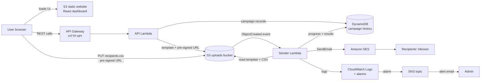

# MailStream: Serverless Bulk Email Dispatch on AWS

MailStream is an event-driven, fully serverless bulk email system built on AWS.
You upload a recipient list (CSV) and an HTML template in a web dashboard. AWS
then personalises and sends one email per recipient, tracks every delivery, and
alerts you when something fails.

It's inspired by [MailMatrix (AWS-Project-04)](https://github.com/NotHarshhaa/AWS-Projects/tree/master/AWS-Project-04),
redesigned with a web UI, campaign tracking, least-privilege IAM and full
infrastructure-as-code. Everything runs inside the AWS Free Tier.

---

## Architecture



### How a campaign flows

1. The dashboard (React, hosted on S3) is opened in the browser.
2. **Create campaign:** the UI calls `POST /campaigns` on API Gateway. The API
   Lambda saves the HTML template to S3 and creates a DynamoDB record with
   status `AWAITING_UPLOAD`. It then returns a **pre-signed S3 URL**, valid for 5 minutes.
3. **Upload:** the browser uploads `recipients.csv` straight to S3 with that URL.
   No AWS keys are ever in the browser.
4. **Event trigger:** S3 fires an `ObjectCreated` event (filtered to
   `campaigns/*/recipients.csv`) that invokes the **Sender Lambda**.
5. **Send:** the Lambda parses the CSV, validates and de-duplicates the
   addresses, and renders the template per recipient (`{{name}}`, `{{email}}`
   or any CSV column). It sends each email through **Amazon SES** (HTML plus a
   plain-text fallback), rate-limited to the account's SES send rate.
6. **Track:** progress and per-recipient results are written to **DynamoDB**.
   The dashboard polls `GET /campaigns` and shows live progress.
7. **Monitor:** logs go to **CloudWatch**. Alarms on Lambda errors and on
   failed sends notify the admin by email through **SNS**.

### AWS services used

| Service | Purpose |
|---|---|
| **Amazon S3** | Hosts the dashboard (static website). Stores templates and recipient CSVs (encrypted, auto-deleted after 30 days). |
| **AWS Lambda** | `mailstream-api` serves the REST API. `mailstream-sender` processes CSVs and sends mail. Python 3.12. |
| **Amazon API Gateway** | HTTP API with CORS and throttling, in front of the API Lambda. |
| **Amazon SES** | Sends the emails. Sender and recipient identities are verified while the account is in the sandbox. |
| **Amazon DynamoDB** | Campaign history, counters and per-recipient delivery results. |
| **Amazon CloudWatch** | Logs (14-day retention), a metric filter for failed sends, and alarms. |
| **Amazon SNS** | Emails the admin when an alarm fires. |
| **AWS IAM** | A separate least-privilege role per Lambda. The sender can only send `From` the verified sender address. |
| **Terraform** | Infrastructure as code: one command creates or destroys the whole stack. |

### Design decisions

- **Event-driven and decoupled:** uploading and sending are separate. The UI
  never waits on SES, so large lists can't time out the API.
- **Pre-signed uploads:** the browser gets a single-use, 5-minute, single-key
  upload permission instead of AWS credentials.
- **Least privilege:**
  - The API role can only write `campaigns/*` objects and touch one table.
  - The sender role can only read `campaigns/*`.
  - The sender role's `ses:SendEmail` is conditioned on `ses:FromAddress`.
- **Idempotent sending:** if S3 delivers an event twice or Lambda retries, the
  sender skips campaigns that already started, so recipients never get duplicates.
- **Free-tier friendly:**
  - DynamoDB uses provisioned 5/5 capacity.
  - Logs expire after 14 days and uploads after 30 days.
  - API Gateway is throttled.
  - SES sending is rate-limited.

---

## Project structure

```
MailStream/
├── frontend/               React + Vite dashboard
│   └── src/                App, campaign form, history, CSV parser, templates
├── lambda/
│   ├── api/handler.py      REST API (create campaign, list, details, SES quota)
│   └── sender/handler.py   S3-triggered bulk sender
├── infra/                  Terraform (S3, Lambda, API GW, SES, DynamoDB, CloudWatch, SNS, IAM)
├── samples/recipients.csv  Example recipient list
└── scripts/
    ├── deploy.sh           Terraform apply + build and upload the dashboard
    └── destroy.sh          Delete everything
```

---

## Deploy it yourself

### Prerequisites
- An AWS account and an IAM user with an access key (`aws configure`)
- AWS CLI v2, Terraform ≥ 1.5, Node.js ≥ 18

### Steps

```bash
git clone https://github.com/js0547/MailStream.git
cd MailStream
cp infra/terraform.tfvars.example infra/terraform.tfvars   # then edit it
./scripts/deploy.sh
```

`terraform.tfvars`:

```hcl
aws_region      = "eu-north-1"
sender_email    = "you@example.com"        # emails are sent from this address
test_recipients = ["friend@example.com"]   # sandbox: recipients must be verified
alert_email     = "you@example.com"        # receives failure alerts
```

After the first deploy:
1. **Click the verification links** that AWS SES emails to the sender and to each test recipient.
2. **Confirm the SNS subscription** email sent to `alert_email`.
3. Open the `dashboard_url` printed at the end of the deploy.

### Using the dashboard
1. Enter a campaign name.
2. Drop in a CSV. It needs an `email` column, and every other column becomes a
   placeholder (see [`samples/recipients.csv`](samples/recipients.csv)).
3. Pick a starter template or edit the HTML, and check the live preview.
4. Click **Send**. Watch the progress bar, then open the campaign to see each recipient's result.

### Tear down
```bash
./scripts/destroy.sh
```

---

## Notes and limits
- **SES sandbox:** new AWS accounts can only send to verified addresses (200
  emails a day, 1 per second). To email anyone, request production access in
  the SES console.
- **HTTP dashboard:** new AWS accounts can't create CloudFront distributions
  until AWS Support verifies them, so the dashboard is served from the S3
  website endpoint (HTTP). Once the account is verified, put CloudFront in
  front of it for HTTPS.
- **No login:** the dashboard has no authentication. It's meant for demos. Add
  Amazon Cognito before using it for anything real.
- One campaign is capped at 500 recipients (`max_recipients_per_campaign`). The
  sender Lambda's 15-minute limit allows about 800 emails at the sandbox rate.

## Tech stack
AWS (S3, Lambda, API Gateway, SES, DynamoDB, CloudWatch, SNS, IAM) · Terraform · Python 3.12 · React 18 · Vite
